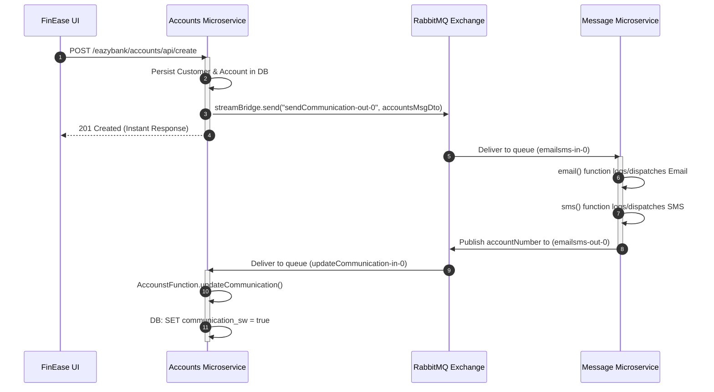

# FinEase Banking Microservices: End-to-End Architecture & Request Flow

> A comprehensive, "0 to Hero" deep dive into the FinEase digital banking platform: User Registration, OIDC PKCE Authentication, Token Storage, Gateway Authorization, Synchronous Feign Communication, and Asynchronous RabbitMQ Event-Driven Messaging.

---

## Table of Contents

1. [High-Level Architecture Overview](#1-high-level-architecture-overview)
2. [Phase 1: User Registration & Onboarding](#2-phase-1-user-registration--onboarding)
3. [Phase 2: Authentication Flow (OIDC + OAuth2 + PKCE)](#3-phase-2-authentication-flow-oidc--oauth2--pkce)
4. [Phase 3: Token Storage & Reactive State Management](#4-phase-3-token-storage--reactive-state-management)
5. [Phase 4: API Gateway, Token Verification & Role Evaluation](#5-phase-4-api-gateway-token-verification--role-evaluation)
6. [Phase 5: Synchronous Microservice Communication (OpenFeign)](#6-phase-5-synchronous-microservice-communication-openfeign)
7. [Phase 6: Asynchronous Event-Driven Messaging (RabbitMQ)](#7-phase-6-asynchronous-event-driven-messaging-rabbitmq)
8. [Summary & Reference Matrix](#8-summary--reference-matrix)

---

## 1. High-Level Architecture Overview

```mermaid
flowchart TD
    subgraph Client ["Frontend: FinEase UI (Angular 19/20)"]
        UI["SPA Application (localhost:4200)"]
        Storage["Browser Storage\n• sessionStorage (finease_auth_tokens)\n• localStorage (finease_current_user)\n• PKCE Verifier"]
        Interceptor["authInterceptor\nBearer JWT Injection & Auto Refresh"]
    end

    subgraph IAM ["Identity & Access Management"]
        KC["Keycloak Server (localhost:7080)\nRealm: eazybank | Client: finease-ui\n• /protocol/openid-connect/auth\n• /protocol/openid-connect/token\n• /protocol/openid-connect/certs"]
    end

    subgraph Gateway ["Edge: API Gateway (Port 8072)"]
        GW["Spring Cloud Gateway (WebFlux)"]
        SecConfig["SecurityWebFilterChain (OAuth2 Resource Server)\nValidates JWT signature against Keycloak JWKS"]
        RoleConv["KeyclockRoleConverter\nMaps realm_access & resource_access to ROLE_*"]
        RouteConfig["Route Locator\n• Path Rewriting • Circuit Breaker • Redis Rate Limiter"]
    end

    subgraph Mesh ["Service Mesh & Discovery"]
        Eureka["Eureka Server (Port 8070)\nService Registry & Discovery"]
        ConfigSrv["Config Server (Port 8071)\nCentral Configuration"]
        
        Accounts["Accounts Service (8080)\n• Accounts & Customer JPA\n• OpenFeign Client\n• StreamBridge Producer"]
        Cards["Cards Service (9000)\n• Credit/Debit Card APIs"]
        Loans["Loans Service (8090)\n• Loan Sanctions & APIs"]
        Message["Message Service (9010)\n• Spring Cloud Function (email | sms)"]
    end

    subgraph Messaging ["Message Broker"]
        RabbitMQ["RabbitMQ (Port 5672 / 15672)\n• Exchange: send-communication\n• Exchange: communication-sent"]
    end

    %% Interactions
    UI <-->|1. OIDC PKCE Auth & Token Exchange| KC
    UI -->|2. Store Tokens| Storage
    Storage -->|3. Read Token| Interceptor
    Interceptor -->|4. HTTP Request + Bearer JWT| GW
    GW <-->|5. Fetch JWKS Public Keys| KC
    GW -->|6. Convert Roles & Enforce Rules| RoleConv
    GW <-->|7. Discover Services| Eureka
    GW -->|8. Routed HTTP (lb://ACCOUNTS)| Accounts
    
    Accounts -->|9. Sync REST (OpenFeign)| Cards
    Accounts -->|10. Sync REST (OpenFeign)| Loans
    Accounts -->|11. Async Event (StreamBridge)| RabbitMQ
    RabbitMQ -->|12. Consume emailsms-in-0| Message
    Message -->|13. Produce communication-sent| RabbitMQ
    RabbitMQ -->|14. Consume updateCommunication-in-0| Accounts
```

---

## 2. Phase 1: User Registration & Onboarding

When an unregistered user signs up for a new bank account:

### 1. User Form Submission
- **Source**: `fin-ease-ui/src/app/features/auth/signup/signup.component.html`
- **User Inputs**: Full Name, Email Address, Mobile Number.
- **Action**: Angular sends `POST /eazybank/accounts/api/create` (or `/api/register`) to the Gateway (`http://localhost:8072`).

### 2. Public Endpoint Bypass at Gateway
In `gatewayserver/src/main/java/com/easybank/gatewayserver/config/SecurityConfig.java`:
```java
.pathMatchers("/eazybank/accounts/api/register", "/eazybank/accounts/api/create").permitAll()
.pathMatchers(HttpMethod.OPTIONS).permitAll()
```
The Gateway recognizes this path as public, permitting traffic without requiring an existing `Authorization` bearer token.

### 3. Route Rewriting & Load Balancing
In `gatewayserver/src/main/java/com/easybank/gatewayserver/GatewayserverApplication.java`:
```java
.route(p -> p
    .path("/eazybank/accounts/**")
    .filters(f -> f
        .rewritePath("/eazybank/accounts/(?<segment>.*)", "/${segment}")
        .circuitBreaker(config -> config.setName("accounsCircuitBreaker")
                                        .setFallbackUri("forward:/contactSupport"))
    )
    .uri("lb://ACCOUNTS")
)
```
- Gateway queries **Eureka Discovery Server** (`localhost:8070`) for an available instance of `ACCOUNTS`.
- Strips the `/eazybank/accounts` prefix and forwards `/api/create` directly to `accounts:8080`.

### 4. Account & Customer Creation
In `accounts/src/main/java/com/eazybytes/accounts/service/AccountServiceImpl.java`:
```java
@Override
public void createAccount(CustomerDto customerDto) {
    Customer customer = CustomerMapper.mapToCustomer(customerDto, new Customer());
    
    // 1. Verify customer does not already exist
    Optional<Customer> optionalCustomer = customerRepository.findByMobileNumber(customerDto.getMobileNumber());
    if (optionalCustomer.isPresent()) {
        throw new CustomerAlreadyExistsException("Customer already exists with mobile number " + customerDto.getMobileNumber());
    }
    
    // 2. Persist Customer and generate default Savings Account
    Customer savedCustomer = customerRepository.save(customer);
    Accounts savedAccount = accountRepository.save(createNewAccount(savedCustomer));
    
    // 3. Trigger asynchronous messaging event
    sendCommunication(savedAccount, savedCustomer);
}
```
At this point, the account is created, and an asynchronous notification message is pushed to RabbitMQ (detailed in [Phase 6](#7-phase-6-asynchronous-event-driven-messaging-rabbitmq)).

---

## 3. Phase 2: Authentication Flow (OIDC + OAuth2 + PKCE)

FinEase implements the industry-standard **Authorization Code Grant with Proof Key for Code Exchange (PKCE - RFC 7636)**.

### Why PKCE for Single Page Applications (SPAs)?
In browser-based applications, client secrets cannot be securely stored. PKCE eliminates the need for client secrets by generating a dynamic, one-time cryptographic proof in the browser.

```
[ Angular UI (Client) ]               [ Keycloak Server (IAM) ]
         |                                        |
         |-- 1. Generate code_verifier (64 bytes) |
         |-- 2. Hash: code_challenge = S256(...)  |
         |                                        |
         |-- 3. Redirect to /protocol/auth ------>|
         |      (?client_id=finease-ui            |
         |       &response_type=code              |
         |       &code_challenge=XYZ              |
         |       &code_challenge_method=S256)     |
         |                                        |
         |    [ User Logs In on Keycloak Screen ] |
         |                                        |
         |<-- 4. Redirect to /dashboard?code=ABC -|
         |                                        |
         |-- 5. POST to /protocol/token --------->|
         |      (grant_type=authorization_code    |
         |       &code=ABC                        |
         |       &code_verifier=64_bytes_secret)  |
         |                                        |
         |    [ Keycloak verifies SHA256 match ]  |
         |                                        |
         |<-- 6. Issue Tokens (JSON) -------------|
         |       { access_token (JWT),            |
         |         refresh_token, id_token }      |
```

### Code Implementation:
In `fin-ease-ui/src/app/core/services/auth.service.ts`:
1. **Generating Challenge & Verifier**:
   ```typescript
   const codeVerifier = generateCodeVerifier(64);
   const codeChallenge = await generatePkceChallenge(codeVerifier);
   sessionStorage.setItem('finease_pkce_verifier', codeVerifier);
   ```
2. **Redirecting to Authorization Endpoint**:
   ```typescript
   const authUrl = new URL('http://localhost:7080/realms/eazybank/protocol/openid-connect/auth');
   authUrl.searchParams.set('client_id', 'finease-ui');
   authUrl.searchParams.set('response_type', 'code');
   authUrl.searchParams.set('scope', 'openid profile email roles');
   authUrl.searchParams.set('redirect_uri', 'http://localhost:4200/dashboard');
   authUrl.searchParams.set('code_challenge', codeChallenge);
   authUrl.searchParams.set('code_challenge_method', 'S256');
   window.location.href = authUrl.toString();
   ```
3. **Handling the Code Callback**:
   When redirected back to `/dashboard?code=XYZ`:
   ```typescript
   const payload = new URLSearchParams();
   payload.set('grant_type', 'authorization_code');
   payload.set('client_id', 'finease-ui');
   payload.set('code', code);
   payload.set('redirect_uri', 'http://localhost:4200/dashboard');
   payload.set('code_verifier', codeVerifier);

   const res = await fetch('http://localhost:7080/realms/eazybank/protocol/openid-connect/token', {
     method: 'POST',
     headers: { 'Content-Type': 'application/x-www-form-urlencoded' },
     body: payload.toString()
   });
   const tokens: AuthTokens = await res.json();
   ```

---

## 4. Phase 3: Token Storage & Reactive State Management

### Where Are the Tokens Stored?

```
Browser Environment
│
├── sessionStorage
│   ├── finease_auth_tokens       --> { access_token, refresh_token, id_token, expires_in }
│   └── finease_pkce_verifier     --> Temporary 64-byte random string (removed after exchange)
│
├── localStorage
│   ├── finease_auth_tokens       --> Redundant copy for tab persistence & silent refresh
│   └── finease_current_user      --> { id, username, name, email, roles }
│
└── Angular Reactive Signals (Memory)
    ├── accessToken()             --> In-memory JWT string
    ├── refreshTokenValue()       --> In-memory refresh token string
    ├── currentUser()             --> In-memory AuthUser object
    ├── isAuthenticated()         --> Computed: !!currentUser()
    └── userRoles()               --> Computed: ['ADMIN', 'MANAGER', 'USER']
```

### Transparent Token Refresh & Silent Renewal
When the access token expires (typically after 5 or 15 minutes):
1. The functional HTTP Interceptor (`auth.interceptor.ts`) intercepts any `401 Unauthorized` response.
2. It pauses pending requests and calls `authService.refreshToken()`.
3. An HTTP POST request is sent to Keycloak with `grant_type=refresh_token`.
4. New tokens are written to storage and memory signals, and failed HTTP requests are automatically retried with the new `access_token`.

---

## 5. Phase 4: API Gateway, Token Verification & Role Evaluation

Every outgoing API call from the frontend passes through the functional interceptor:
```typescript
// fin-ease-ui/src/app/core/interceptors/auth.interceptor.ts
authReq = req.clone({
  setHeaders: {
    Authorization: `Bearer ${token}`
  }
});
return next(authReq);
```

### 1. Signature & Expiration Verification
In `gatewayserver/src/main/resources/application.yaml`:
```yaml
spring:
  security:
    oauth2:
      resourceserver:
        jwt:
          jwk-set-uri: "http://localhost:7080/realms/eazybank/protocol/openid-connect/certs"
```
The Gateway acts as an **OAuth2 Resource Server**. It automatically downloads and caches Keycloak's cryptographic public keys (JWKS). When a request arrives:
- Validates that the token was signed with Keycloak's private key.
- Verifies that the token is not expired (`exp`).
- Confirms the issuer (`iss`) is `http://localhost:7080/realms/eazybank`.

### 2. Role Conversion (`KeyclockRoleConverter`)
Keycloak stores user permissions in structured JSON claims:
```json
{
  "realm_access": {
    "roles": ["ADMIN", "MANAGER", "USER"]
  },
  "resource_access": {
    "finease-ui": {
      "roles": ["ACCOUNTS", "CARDS", "LOANS"]
    }
  }
}
```

In `gatewayserver/src/main/java/com/easybank/gatewayserver/config/KeyclockRoleConverter.java`:
```java
public class KeyclockRoleConverter implements Converter<Jwt, Collection<GrantedAuthority>> {
    @Override
    public Collection<GrantedAuthority> convert(Jwt source) {
        List<GrantedAuthority> grantedAuthorities = new ArrayList<>();

        // 1. Extract Realm Roles (ADMIN, MANAGER, USER)
        Map<String, Object> realmAccess = (Map<String, Object>) source.getClaims().get("realm_access");
        if (realmAccess != null && realmAccess.containsKey("roles")) {
            List<String> roles = (List<String>) realmAccess.get("roles");
            roles.stream()
                .map(roleName -> "ROLE_" + roleName.toUpperCase())
                .map(SimpleGrantedAuthority::new)
                .forEach(grantedAuthorities::add);
        }

        // 2. Extract Client Resource Roles (ACCOUNTS, CARDS, LOANS)
        Map<String, Object> resourceAccess = (Map<String, Object>) source.getClaims().get("resource_access");
        if (resourceAccess != null) {
            resourceAccess.values().forEach(resource -> {
                if (resource instanceof Map<?, ?> clientMap) {
                    Object rolesObj = clientMap.get("roles");
                    if (rolesObj instanceof List<?> clientRoles) {
                        clientRoles.stream()
                            .map(Object::toString)
                            .map(roleName -> "ROLE_" + roleName.toUpperCase())
                            .map(SimpleGrantedAuthority::new)
                            .forEach(grantedAuthorities::add);
                    }
                }
            });
        }
        return grantedAuthorities;
    }
}
```

### 3. Route Authorization Enforcement
In `gatewayserver/src/main/java/com/easybank/gatewayserver/config/SecurityConfig.java`:
```java
.authorizeExchange(e -> e
    .pathMatchers(HttpMethod.OPTIONS).permitAll()
    .pathMatchers("/eazybank/accounts/api/register", "/eazybank/accounts/api/create").permitAll()
    .pathMatchers("/actuator/**", "/swagger-ui/**", "/v3/api-docs/**").permitAll()
    
    // Strict Admin Endpoint Protection
    .pathMatchers("/eazybank/*/api/admin/**").hasRole("ADMIN")
    
    // Manager or Admin loan sanctions
    .pathMatchers("/eazybank/loans/api/approve/**").hasAnyRole("MANAGER", "ADMIN")
    
    // Microservice endpoint role enforcement
    .pathMatchers("/eazybank/accounts/**").hasAnyRole("ACCOUNTS", "USER", "MANAGER", "ADMIN")
    .pathMatchers("/eazybank/cards/**").hasAnyRole("CARDS", "USER", "MANAGER", "ADMIN")
    .pathMatchers("/eazybank/loans/**").hasAnyRole("LOANS", "USER", "MANAGER", "ADMIN")
    .anyExchange().authenticated()
)
```
- If a user with role `USER` attempts to access `/eazybank/loans/api/admin/rates`, Spring Security matches `hasRole("ADMIN")` against the authorities (`ROLE_USER`).
- A `403 Forbidden` response is returned immediately at the API Gateway without ever burdening downstream microservices.

---

## 6. Phase 5: Synchronous Microservice Communication (OpenFeign)

When a customer views their dashboard, `accounts` needs to return a consolidated view containing the user's **Accounts**, **Cards**, and **Loans**.

```
[ API Gateway ]
       │
       ▼
[ ACCOUNTS Microservice ] ──(CustomerServiceImpl)
       │
       ├── 1. Sync HTTP via OpenFeign ────► [ CARDS Microservice ] (Port 9000)
       │                                         └── Returns CardsDto
       │
       └── 2. Sync HTTP via OpenFeign ────► [ LOANS Microservice ] (Port 8090)
                                                 └── Returns LoansDto
       │
       ▼
[ Aggregated CustomerDetailsDto ] ──► Returned to UI
```

### Declarative Feign Clients with Resilience Fallbacks:
In `accounts/src/main/java/com/eazybytes/accounts/service/clients/CardsFeignClient.java`:
```java
@FeignClient(name = "cards", fallback = CardsFallback.class)
public interface CardsFeignClient {
    @GetMapping(value = "/api/fetch", consumes = "application/json")
    ResponseEntity<CardsDto> fetchCardDetails(
        @RequestHeader("eazybank-correlation-id") String correlationId,
        @RequestParam String mobileNumber
    );
}
```

In `accounts/src/main/java/com/eazybytes/accounts/service/CustomerServiceImpl.java`:
```java
@Override
public CustomerDetailsDto fetchCustomerDetails(String mobileNumber, String correlationId) {
    Customer customer = customerRepository.findByMobileNumber(mobileNumber)
        .orElseThrow(() -> new ResourceNotFoundException("Customer", "mobileNumber", mobileNumber));
    Accounts accounts = accountRepository.findByCustomerId(customer.getCustomerId())
        .orElseThrow(() -> new ResourceNotFoundException("Account", "customerId", customer.getCustomerId().toString()));

    CustomerDetailsDto customerDetailsDto = CustomerMapper.mapToCustomerDetailsDto(customer, new CustomerDetailsDto());
    customerDetailsDto.setAccountsDto(AccountsMapper.mapToAccountsDto(accounts, new AccountsDto()));

    // Synchronous calls to Cards and Loans services:
    ResponseEntity<CardsDto> cardsDtoResponseEntity = cardsFeignClient.fetchCardDetails(correlationId, mobileNumber);
    if (cardsDtoResponseEntity != null) {
        customerDetailsDto.setCardsDto(cardsDtoResponseEntity.getBody());
    }

    ResponseEntity<LoansDto> loansDtoResponseEntity = loansFeignClient.fetchLoanDetails(correlationId, mobileNumber);
    if (loansDtoResponseEntity != null) {
        customerDetailsDto.setLoansDto(loansDtoResponseEntity.getBody());
    }

    return customerDetailsDto;
}
```

### Circuit Breaker Fallback Graceful Degradation
If `cards` or `loans` goes down:
- The fallback class (`CardsFallback.java` or `LoansFallback.java`) intercepts the timeout or connection failure.
- Returns `null` or a placeholder object instead of crashing the request.
- The user still sees their account balance with a notification that loan/card details are temporarily unavailable.

---

## 7. Phase 6: Asynchronous Event-Driven Messaging (RabbitMQ)

When an account is created or contact info is updated, the system avoids slow third-party email/SMS API calls in the HTTP request thread by using **Spring Cloud Stream** with **RabbitMQ**.



### 1. The Producer in `accounts`:
In `accounts/src/main/java/com/eazybytes/accounts/service/AccountServiceImpl.java`:
```java
private void sendCommunication(Accounts account, Customer customer) {
    var accountsMsgDto = new AccountsMsgDto(account.getAccountNumber(), customer.getName(),
            customer.getEmail(), customer.getMobileNumber());
    log.info("Sending Communication request for the details: {}", accountsMsgDto);
    var result = streamBridge.send("sendCommunication-out-0", accountsMsgDto);
    log.info("Is the Communication request successfully triggered? : {}", result);
}
```
In `accounts/src/main/resources/application.yml`:
```yaml
spring:
  cloud:
    stream:
      bindings:
        sendCommunication-out-0:
          destination: send-communication
        updateCommunication-in-0:
          destination: communication-sent
          group: accounts
```

### 2. The Functional Consumer in `message`:
In `message/src/main/resources/application.yaml`:
```yaml
spring:
  cloud:
    function:
      definition: email|sms
    stream:
      bindings:
        emailsms-in-0:
          destination: send-communication
          group: message
        emailsms-out-0:
          destination: communication-sent
```

In `message/src/main/java/com/eazybytes/message/functions/MessageFunctions.java`:
```java
@Configuration
public class MessageFunctions {
    private static final Logger logger = LoggerFactory.getLogger(MessageFunctions.class);

    @Bean
    public Function<AccountsMessageDto, AccountsMessageDto> email() {
        return accountsMessageDto -> {
            logger.info("Sending email with details: " + accountsMessageDto.toString());
            return accountsMessageDto; // Passes forward to SMS function
        };
    }

    @Bean
    public Function<AccountsMessageDto, Long> sms() {
        return accountsMessageDto -> {
            logger.info("Sending sms with details: " + accountsMessageDto.toString());
            return accountsMessageDto.accountNumber(); // Emitted to communication-sent exchange
        };
    }
}
```

### 3. The Callback & State Update:
In `accounts/src/main/java/com/eazybytes/accounts/functions/AccounstFunction.java`:
```java
@Configuration
public class AccounstFunction {
    private static final Logger log = LoggerFactory.getLogger(AccounstFunction.class);

    @Bean
    public Consumer<Long> updateCommunication(IAccountService accountService) {
        return accountNumber -> {
            log.info("Updating communication status for account number : {}", accountNumber.toString());
            accountService.updateCommunicationStatus(accountNumber);
        };
    }
}
```
When `updateCommunicationStatus(accountNumber)` executes, it updates the `communication_sw` column in the database from `false` to `true`, successfully closing the asynchronous feedback loop.

---

## 8. Summary & Reference Matrix

| Aspect | Technology | Port / Endpoint | Responsibility |
| :--- | :--- | :--- | :--- |
| **Frontend UI** | Angular 19/20, Angular Material | `http://localhost:4200` | Single Page Application, OIDC PKCE client, reactive signals |
| **Identity Provider** | Keycloak IAM | `http://localhost:7080` | Realm `eazybank`, client `finease-ui`, issues RS256 JWT tokens |
| **Config Server** | Spring Cloud Config Server | `http://localhost:8071` | Centralized external configuration repository |
| **Service Discovery** | Netflix Eureka Server | `http://localhost:8070` | Dynamic service registration and heartbeat health monitoring |
| **API Gateway** | Spring Cloud Gateway | `http://localhost:8072` | Reverse proxy, path rewriting, Redis rate limiting, circuit breaker, OAuth2 resource server |
| **Accounts Service** | Spring Boot, Data JPA, H2/MySQL | `http://localhost:8080` | Core banking accounts, OpenFeign client, RabbitMQ producer |
| **Cards Service** | Spring Boot, Data JPA | `http://localhost:9000` | Credit/Debit cards microservice |
| **Loans Service** | Spring Boot, Data JPA | `http://localhost:8090` | Customer loans and sanction approvals |
| **Message Service** | Spring Cloud Function & Stream | `http://localhost:9010` | RabbitMQ event consumer (`email\|sms`) |
| **Message Broker** | RabbitMQ | `5672` (AMQP) / `15672` (Management UI) | Exchanges `send-communication` and `communication-sent` |
