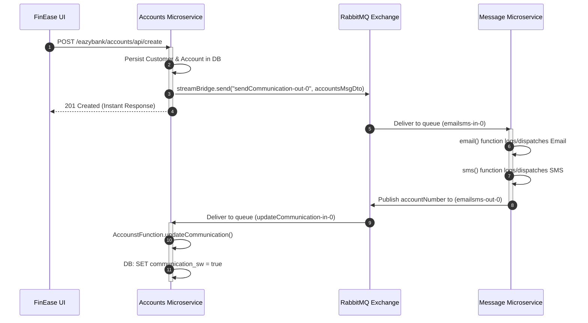

# FinEase Banking Microservices: End-to-End Architecture & Request Flow

> A comprehensive, "0 to Hero" deep dive into the FinEase digital banking platform: User Registration & Keycloak IAM Sync, OIDC PKCE & Direct Grant Authentication, Token Storage & Refresh Resilience, Gateway Authorization, Synchronous Feign Aggregation (`fetchCustomerDetails`), and Asynchronous RabbitMQ Event-Driven Messaging.

---

## Table of Contents

1. [High-Level Architecture Overview](#1-high-level-architecture-overview)
2. [Phase 1: User Registration, Account Creation & Keycloak IAM Sync](#2-phase-1-user-registration-account-creation--keycloak-iam-sync)
3. [Phase 2: Authentication Flows (OIDC PKCE & Direct Password Grant)](#3-phase-2-authentication-flows-oidc-pkce--direct-password-grant)
4. [Phase 3: Token Storage, State Management & Refresh Resilience](#4-phase-3-token-storage-state-management--refresh-resilience)
5. [Phase 4: API Gateway, Token Verification & Role Evaluation](#5-phase-4-api-gateway-token-verification--role-evaluation)
6. [Phase 5: Synchronous Microservice Communication (OpenFeign) & Dashboard Aggregation](#6-phase-5-synchronous-microservice-communication-openfeign--dashboard-aggregation)
7. [Phase 6: Asynchronous Event-Driven Messaging (RabbitMQ)](#7-phase-6-asynchronous-event-driven-messaging-rabbitmq)
8. [Summary & Reference Matrix](#8-summary--reference-matrix)

---

## 1. High-Level Architecture Overview

```mermaid
flowchart TD
    subgraph Client ["Frontend: FinEase UI (Angular)"]
        UI["SPA Application (localhost:4200)"]
        Storage["Browser Storage\n• sessionStorage (tokens, processed_code)\n• localStorage (user, current_mobile)\n• PKCE Verifier"]
        Interceptor["authInterceptor\nBearer JWT Injection & Refresh Guard"]
    end

    subgraph IAM ["Keycloak Identity & Access Management (Port 7080)"]
        KC["Realm: eazybank\n• /protocol/openid-connect/auth\n• /protocol/openid-connect/token\n• /protocol/openid-connect/certs"]
        AdminAPI["Keycloak Admin REST API\n• Client: backend-admin-client\n• POST /admin/realms/eazybank/users\n• POST /role-mappings/realm"]
    end

    subgraph Gateway ["Edge: API Gateway (Port 8072)"]
        GW["Spring Cloud Gateway (WebFlux)"]
        SecConfig["SecurityWebFilterChain (OAuth2 Resource Server)\n• Public: /register, /create, /fetch, /fetchCustomerDetails\n• Validates JWT signature against Keycloak JWKS"]
        RoleConv["KeyclockRoleConverter\nMaps realm_access & resource_access to ROLE_*"]
        RouteConfig["Route Locator\n• Path Rewriting • Circuit Breaker • Redis Rate Limiter"]
    end

    subgraph Mesh ["Service Mesh & Discovery"]
        Eureka["Eureka Server (Port 8070)\nService Registry & Discovery"]
        ConfigSrv["Config Server (Port 8071)\nCentral Configuration"]
        
        Accounts["Accounts Service (8080)\n• Accounts & Customer JPA\n• OpenFeign Client (Cards & Loans)\n• StreamBridge Producer"]
        Cards["Cards Service (9000)\n• Credit/Debit Card APIs"]
        Loans["Loans Service (8090)\n• Loan Sanctions & APIs"]
        Message["Message Service (9010)\n• Spring Cloud Function (email | sms)"]
    end

    subgraph Messaging ["Message Broker"]
        RabbitMQ["RabbitMQ (Port 5672 / 15672)\n• Exchange: send-communication\n• Exchange: communication-sent"]
    end

    %% Interactions
    UI <-->|1. OIDC PKCE Auth or Direct Grant| KC
    UI -->|2. Sync New User via Admin API| AdminAPI
    UI -->|3. Store Tokens & Current Mobile| Storage
    Storage -->|4. Read Token| Interceptor
    Interceptor -->|5. HTTP Request + Bearer JWT| GW
    GW <-->|6. Fetch JWKS Public Keys| KC
    GW -->|7. Convert Roles & Enforce Rules| RoleConv
    GW <-->|8. Discover Services| Eureka
    GW -->|9. Routed HTTP (lb://ACCOUNTS)| Accounts
    
    Accounts -->|10. Sync REST (OpenFeign)| Cards
    Accounts -->|11. Sync REST (OpenFeign)| Loans
    Accounts -->|12. Async Event (StreamBridge)| RabbitMQ
    RabbitMQ -->|13. Consume emailsms-in-0| Message
    Message -->|14. Produce communication-sent| RabbitMQ
    RabbitMQ -->|15. Consume updateCommunication-in-0| Accounts
```

---

## 2. Phase 1: User Registration, Account Creation & Keycloak IAM Sync

When a new user registers on `/signup`:

```
[ User on /signup ]
       │
       ├─────────────────────────────────────────┐
       ▼                                         ▼
1. POST /eazybank/accounts/api/create    2. Keycloak Admin User Sync
   (Payload: Name, Email, Mobile)            (backend-admin-client)
       │                                         │
       ▼                                         ▼
[ Accounts Service (8080) ]              [ Keycloak Realm (7080) ]
• Persist Customer & Account             • Create user & set attributes
• Trigger RabbitMQ Notification          • Set user password (temporary=false)
                                         • Assign roles (USER, ACCOUNTS, CARDS, LOANS)
```

### 1. User Form Submission
- **Source**: `fin-ease-ui/src/app/features/auth/signup/signup.component.ts`
- **User Inputs**: Full Name, Email Address, Mobile Number, Password.
- **Action**: 
  1. Sends `POST /eazybank/accounts/api/create` to Gateway (`http://localhost:8072`).
  2. Simultaneously invokes `authService.syncKeycloakUser(...)` to register credentials and roles in Keycloak.
  3. Saves `finease_current_mobile` in `localStorage` for dynamic dashboard reloads.

```typescript
// fin-ease-ui/src/app/features/auth/signup/signup.component.ts
const customerDto: CustomerDto = {
  name: name.trim(),
  email: email.trim().toLowerCase(),
  mobileNumber: mobileNumber.trim(),
  accountsDto: {
    accountType: 'Savings Account',
    branchAddress: 'Pune Main Branch'
  }
};

// 1. Create Core Banking Account
await firstValueFrom(this.api.createAccount(customerDto));

// 2. Synchronize Identity with Keycloak IAM
await this.authService.syncKeycloakUser(
  name.trim(),
  email.trim().toLowerCase(),
  mobileNumber.trim(),
  password
);
```

### 2. Public Endpoint Gateway Bypass
In `gatewayserver/src/main/java/com/easybank/gatewayserver/config/SecurityConfig.java`:
```java
.authorizeExchange(e -> e
    .pathMatchers(HttpMethod.OPTIONS).permitAll()
    // Public endpoints: User Registration, Account/Card/Loan Operations, Actuator health, API docs
    .pathMatchers(
            "/eazybank/accounts/api/register",
            "/eazybank/accounts/api/create",
            "/eazybank/accounts/api/fetch",
            "/eazybank/accounts/api/fetchCustomerDetails",
            "/eazybank/cards/api/create",
            "/eazybank/cards/api/fetch",
            "/eazybank/loans/api/create",
            "/eazybank/loans/api/fetch"
    ).permitAll()
    .pathMatchers("/actuator/**", "/swagger-ui/**", "/v3/api-docs/**").permitAll()
    ...
```
The Gateway recognizes these onboarding and operational paths as public, allowing traffic without requiring an existing bearer token.

### 3. Keycloak IAM User Synchronization (`backend-admin-client`)
In `fin-ease-ui/src/app/core/services/auth.service.ts`:
1. **Admin Token Generation**: Uses confidential client `backend-admin-client` with client credentials grant (`grant_type=client_credentials`, secret: `backend-admin-secret`).
2. **User Existence Check**: Queries `GET /admin/realms/eazybank/users?username={email}`.
3. **User Creation**: If not present, calls `POST /admin/realms/eazybank/users`:
   ```json
   {
     "username": "customer@eazybank.com",
     "email": "customer@eazybank.com",
     "firstName": "Alex",
     "lastName": "Morgan",
     "enabled": true,
     "emailVerified": true,
     "attributes": {
       "mobileNumber": ["9876543210"]
     },
     "credentials": [
       { "type": "password", "value": "User@123", "temporary": false }
     ]
   }
   ```
4. **Realm Roles Assignment**: Calls `POST /admin/realms/eazybank/users/{id}/role-mappings/realm` to assign:
   - `USER`
   - `ACCOUNTS`
   - `CARDS`
   - `LOANS`

---

## 3. Phase 2: Authentication Flows (OIDC PKCE & Direct Password Grant)

FinEase supports two industry-standard authentication mechanisms:

### Option A: Authorization Code Flow with PKCE (RFC 7636)
Used when logging in via Keycloak's centralized single sign-on (SSO) login page.

```
[ Angular UI (Client) ]               [ Keycloak Server (IAM) ]
         |                                        |
         |-- 1. Generate code_verifier (64 bytes) |
         |-- 2. Hash: code_challenge = S256(...)  |
         |                                        |
         |-- 3. Redirect to /protocol/auth ------>|
         |      (?client_id=finease-ui            |
         |       &response_type=code              |
         |       &code_challenge=XYZ              |
         |       &code_challenge_method=S256)     |
         |                                        |
         |    [ User Logs In on Keycloak Screen ] |
         |                                        |
         |<-- 4. Redirect to /dashboard?code=ABC -|
         |                                        |
         |-- 5. POST to /protocol/token --------->|
         |      (grant_type=authorization_code    |
         |       &code=ABC                        |
         |       &code_verifier=64_bytes_secret)  |
         |                                        |
         |<-- 6. Issue Tokens (JSON) -------------|
```

#### Page Refresh & Single-Use Code Replay Protection
Keycloak authorization codes are **single-use**. If a user refreshes `/dashboard?code=ABC`, re-submitting `ABC` triggers `400 Bad Request: invalid_grant ("Code not valid")`.
FinEase eliminates this via three safeguards in `auth.service.ts`:
1. `sessionStorage.setItem('finease_processed_code', code)` marks the code as handled.
2. `cleanUrlParams()` strips `?code=...&session_state=...` from the browser URL bar immediately after exchange.
3. `restoreStoredSession()` checks for existing valid tokens before initiating any token exchange.

### Option B: Direct Access Grant (Resource Owner Password Credentials)
Used for direct in-app credential login:
```typescript
// fin-ease-ui/src/app/core/services/auth.service.ts
const payload = new URLSearchParams();
payload.set('grant_type', 'password');
payload.set('client_id', 'finease-ui');
payload.set('username', identifier.trim());
payload.set('password', password);

const response = await fetch('http://localhost:7080/realms/eazybank/protocol/openid-connect/token', {
  method: 'POST',
  headers: { 'Content-Type': 'application/x-www-form-urlencoded' },
  body: payload.toString()
});
const tokens: AuthTokens = await response.json();
```

---

## 4. Phase 3: Token Storage, State Management & Refresh Resilience

### Where Are Tokens & State Stored?

```
Browser Environment
│
├── sessionStorage
│   ├── finease_auth_tokens       --> { access_token, refresh_token, id_token, expires_in }
│   ├── finease_processed_code    --> Prevents re-exchange of consumed OIDC codes
│   └── finease_pkce_verifier     --> Temporary 64-byte random string (removed after exchange)
│
├── localStorage
│   ├── finease_auth_tokens       --> Redundant copy for multi-tab persistence
│   ├── finease_current_user      --> { id, username, name, email, mobileNumber, roles }
│   ├── finease_current_mobile    --> Current user's active mobile number for API data queries
│   └── finease_registered_users  --> Cached local registry for offline fallback
│
└── Angular Reactive Signals (In-Memory)
    ├── accessToken()             --> In-memory JWT string
    ├── currentUser()             --> In-memory AuthUser object
    ├── isAuthenticated()         --> Computed: !!currentUser()
    └── userRoles()               --> Computed: ['ADMIN', 'MANAGER', 'USER']
```

### Transparent Token Refresh
1. When the access token expires (configured for 5-15 min in Keycloak):
2. `authInterceptor` catches `401 Unauthorized` responses from protected endpoints.
3. Calls `authService.refreshToken()` using Keycloak's `grant_type=refresh_token`.
4. Updates tokens in memory and storage, and automatically retries the original request.
5. If the user is on a demo or mock session, `authInterceptor` prevents false logout loops.

---

## 5. Phase 4: API Gateway, Token Verification & Role Evaluation

Every outgoing request from FinEase UI passes through the functional `authInterceptor`:
```typescript
// fin-ease-ui/src/app/core/interceptors/auth.interceptor.ts
if (token && !authService.isMockToken(token)) {
  req = req.clone({
    setHeaders: {
      Authorization: `Bearer ${token}`
    }
  });
}
return next(req);
```

### 1. Cryptographic JWT Verification
In `gatewayserver/src/main/resources/application.yaml`:
```yaml
spring:
  security:
    oauth2:
      resourceserver:
        jwt:
          jwk-set-uri: "http://localhost:7080/realms/eazybank/protocol/openid-connect/certs"
```
The Gateway downloads Keycloak's public keys (JWKS) to verify signatures, issuer (`iss`), and expiration (`exp`).

### 2. Role Conversion (`KeyclockRoleConverter`)
Extracts both realm roles (`realm_access.roles`) and client roles (`resource_access.{client}.roles`) and maps them to Spring Security `ROLE_` authorities:
- Keycloak `ADMIN` $\rightarrow$ `ROLE_ADMIN`
- Keycloak `ACCOUNTS` $\rightarrow$ `ROLE_ACCOUNTS`
- Keycloak `CARDS` $\rightarrow$ `ROLE_CARDS`
- Keycloak `LOANS` $\rightarrow$ `ROLE_LOANS`

### 3. Route Authorization Enforcement
```java
// gatewayserver/src/main/java/com/easybank/gatewayserver/config/SecurityConfig.java
.authorizeExchange(e -> e
    .pathMatchers(HttpMethod.OPTIONS).permitAll()
    // Open for onboarding and data fetching
    .pathMatchers(
            "/eazybank/accounts/api/register",
            "/eazybank/accounts/api/create",
            "/eazybank/accounts/api/fetch",
            "/eazybank/accounts/api/fetchCustomerDetails",
            "/eazybank/cards/api/create",
            "/eazybank/cards/api/fetch",
            "/eazybank/loans/api/create",
            "/eazybank/loans/api/fetch"
    ).permitAll()
    // Admin Restricted
    .pathMatchers("/eazybank/*/api/admin/**").hasRole("ADMIN")
    // Manager Sanctions
    .pathMatchers("/eazybank/loans/api/approve/**").hasAnyRole("MANAGER", "ADMIN")
    // Microservice Role Enforcement
    .pathMatchers("/eazybank/accounts/**").hasAnyRole("ACCOUNTS", "USER", "MANAGER", "ADMIN")
    .pathMatchers("/eazybank/cards/**").hasAnyRole("CARDS", "USER", "MANAGER", "ADMIN")
    .pathMatchers("/eazybank/loans/**").hasAnyRole("LOANS", "USER", "MANAGER", "ADMIN")
    .anyExchange().authenticated()
)
```

---

## 6. Phase 5: Synchronous Microservice Communication (OpenFeign) & Dashboard Aggregation

### The Unified Customer Dashboard Workflow

When a user creates a card, applies for a loan, or reloads the dashboard:

```
[ User Action: Reload Dashboard / Create Card / Create Loan ]
                             │
                             ▼
              [ FinEase UI: DashboardComponent ]
    • Resolves active mobileNumber from session/localStorage
    • Calls api.loadUserBankingData(mobileNumber)
                             │
                             ▼
[ Gateway Server (8072) ] ──(lb://ACCOUNTS)──► [ Accounts Service (8080) ]
                                                      │
                                                      │ fetchCustomerDetails(mobileNumber)
                                                      ├─────────────────────────────────────┐
                                                      ▼ (OpenFeign)                         ▼ (OpenFeign)
                                           [ Cards Service (9000) ]              [ Loans Service (8090) ]
                                            GET /api/fetch?mobileNumber=          GET /api/fetch?mobileNumber=
                                                      │                                     │
                                                      ▼                                     ▼
                                                 (CardsDto)                            (LoansDto)
                                                      │                                     │
                                                      └──────────────────┬──────────────────┘
                                                                         ▼
                                                       [ Aggregated CustomerDetailsDto ]
                                                                         │
                                                                         ▼
                                                    [ FinEase UI: Reactive Signals ]
                                                    • accounts.set([details.accountsDto])
                                                    • cards.set(enrichedCards)
                                                    • loans.set(enrichedLoans)
                                                    • overview.set(calculatedTotals)
```

### 1. Declarative OpenFeign Clients
In `accounts/src/main/java/com/eazybytes/accounts/service/clients/CardsFeignClient.java`:
```java
@FeignClient(name = "cards", fallback = CardsFallback.class)
public interface CardsFeignClient {
    @GetMapping(value = "/api/fetch", consumes = "application/json")
    ResponseEntity<CardsDto> fetchCardDetails(
        @RequestHeader("eazybank-correlation-id") String correlationId,
        @RequestParam String mobileNumber
    );
}
```

In `accounts/src/main/java/com/eazybytes/accounts/service/CustomerServiceImpl.java`:
```java
@Override
public CustomerDetailsDto fetchCustomerDetails(String mobileNumber, String correlationId) {
    Customer customer = customerRepository.findByMobileNumber(mobileNumber)
        .orElseThrow(() -> new ResourceNotFoundException("Customer", "mobileNumber", mobileNumber));
    Accounts accounts = accountRepository.findByCustomerId(customer.getCustomerId())
        .orElseThrow(() -> new ResourceNotFoundException("Account", "customerId", customer.getCustomerId().toString()));

    CustomerDetailsDto customerDetailsDto = CustomerMapper.mapToCustomerDetailsDto(customer, new CustomerDetailsDto());
    customerDetailsDto.setAccountsDto(AccountsMapper.mapToAccountsDto(accounts, new AccountsDto()));

    // Synchronous call to Cards Service via OpenFeign
    ResponseEntity<CardsDto> cardsDtoResponseEntity = cardsFeignClient.fetchCardDetails(correlationId, mobileNumber);
    if (cardsDtoResponseEntity != null) {
        customerDetailsDto.setCardsDto(cardsDtoResponseEntity.getBody());
    }

    // Synchronous call to Loans Service via OpenFeign
    ResponseEntity<LoansDto> loansDtoResponseEntity = loansFeignClient.fetchLoanDetails(correlationId, mobileNumber);
    if (loansDtoResponseEntity != null) {
        customerDetailsDto.setLoansDto(loansDtoResponseEntity.getBody());
    }

    return customerDetailsDto;
}
```

### 2. Frontend Presentation Enrichment
Because cards and loans microservice entities store raw financial figures (`totalLimit`, `amountUsed`, `totalLoan`, `amountPaid`), `banking-api.service.ts` enriches these records with display attributes (`cardHolder`, `status: 'ACTIVE'`, `emi`, `nextDueDate`) to ensure all UI components render cards and loans seamlessly.

---

## 7. Phase 6: Asynchronous Event-Driven Messaging (RabbitMQ)

When an account is created, notification emails and SMS messages are dispatched asynchronously using **Spring Cloud Stream** and **RabbitMQ**:



### 1. Producer in `accounts`:
```java
// accounts/src/main/java/com/eazybytes/accounts/service/AccountServiceImpl.java
private void sendCommunication(Accounts account, Customer customer) {
    var accountsMsgDto = new AccountsMsgDto(account.getAccountNumber(), customer.getName(),
            customer.getEmail(), customer.getMobileNumber());
    log.info("Sending Communication request for the details: {}", accountsMsgDto);
    var result = streamBridge.send("sendCommunication-out-0", accountsMsgDto);
    log.info("Is the Communication request successfully triggered? : {}", result);
}
```

### 2. Consumer in `message`:
```java
// message/src/main/java/com/eazybytes/message/functions/MessageFunctions.java
@Bean
public Function<AccountsMessageDto, AccountsMessageDto> email() {
    return accountsMessageDto -> {
        logger.info("Sending email with details: " + accountsMessageDto.toString());
        return accountsMessageDto; // Passes forward to SMS function
    };
}

@Bean
public Function<AccountsMessageDto, Long> sms() {
    return accountsMessageDto -> {
        logger.info("Sending sms with details: " + accountsMessageDto.toString());
        return accountsMessageDto.accountNumber(); // Emitted to communication-sent exchange
    };
}
```

### 3. State Update Callback:
```java
// accounts/src/main/java/com/eazybytes/accounts/functions/AccounstFunction.java
@Bean
public Consumer<Long> updateCommunication(IAccountService accountService) {
    return accountNumber -> {
        log.info("Updating communication status for account number : {}", accountNumber.toString());
        accountService.updateCommunicationStatus(accountNumber);
    };
}
```
Sets `communication_sw = true` in the accounts database, confirming notification delivery without blocking client threads.

---

## 8. Summary & Reference Matrix

### Microservices & Ports

| Component | Port | Health / Swagger / Management | Key Responsibilities |
| :--- | :--- | :--- | :--- |
| **FinEase UI** | `4200` | [http://localhost:4200](http://localhost:4200) | Angular 22 SPA, OIDC PKCE & Direct Grant client, dynamic signals |
| **Keycloak IAM** | `7080` | [http://localhost:7080](http://localhost:7080) | Realm `eazybank`, `finease-ui` (public), `backend-admin-client` (admin) |
| **Config Server**| `8071` | [http://localhost:8071/actuator/health](http://localhost:8071/actuator/health) | Git/local configuration repository |
| **Eureka Server**| `8070` | [http://localhost:8070](http://localhost:8070) | Service registration & discovery registry |
| **API Gateway**  | `8072` | [http://localhost:8072/actuator/gateway/routes](http://localhost:8072/actuator/gateway/routes) | OAuth2 Resource Server, routing, Redis rate limiting, circuit breaker |
| **Accounts**     | `8080` | [http://localhost:8080/swagger-ui.html](http://localhost:8080/swagger-ui.html) | Accounts JPA, OpenFeign aggregator (`fetchCustomerDetails`), RabbitMQ producer |
| **Cards**        | `9000` | [http://localhost:9000/swagger-ui.html](http://localhost:9000/swagger-ui.html) | Card issuance, balance and limit tracking |
| **Loans**        | `8090` | [http://localhost:8090/swagger-ui.html](http://localhost:8090/swagger-ui.html) | Loan creation, interest rates, installment tracking |
| **Message**      | `9010` | Stream Consumer | RabbitMQ Spring Cloud Function pipeline (`email\|sms`) |
| **RabbitMQ**     | `5672` / `15672` | [http://localhost:15672](http://localhost:15672) | Event broker: `send-communication` & `communication-sent` exchanges |
| **Redis**        | `6379` | — | Gateway request rate limiting cache |

### Keycloak Client Setup

| Client ID | Access Type | Primary Grant Types | Purpose |
| :--- | :--- | :--- | :--- |
| `finease-ui` | Public | Authorization Code (PKCE), Password (Direct Access) | Browser SPA authentication and JWT issuance |
| `backend-admin-client` | Confidential | Client Credentials (`grant_type=client_credentials`) | Admin REST API user creation, password reset & role assignment |
| `admin-cli` | Public | Password (Master realm) | System administration and scripting |
