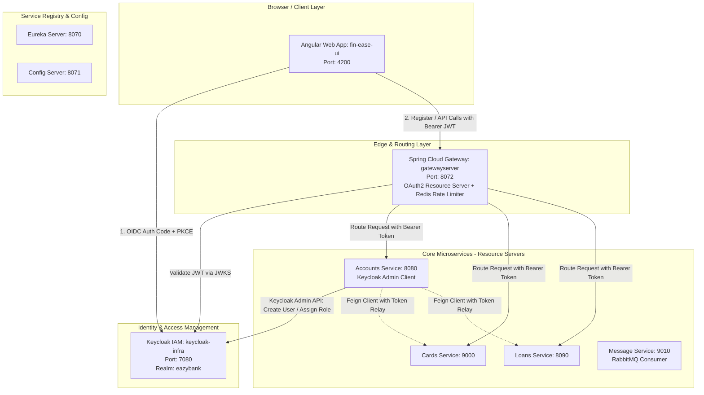
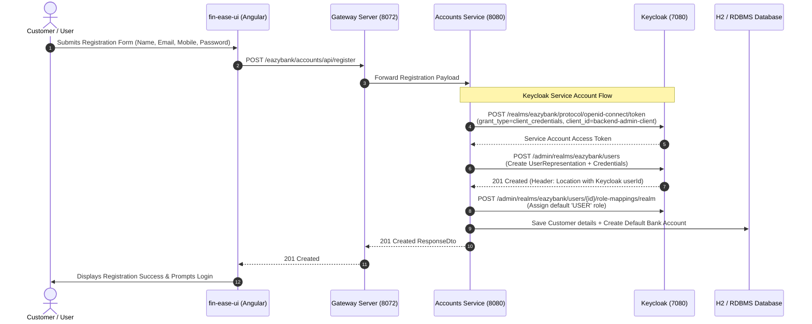
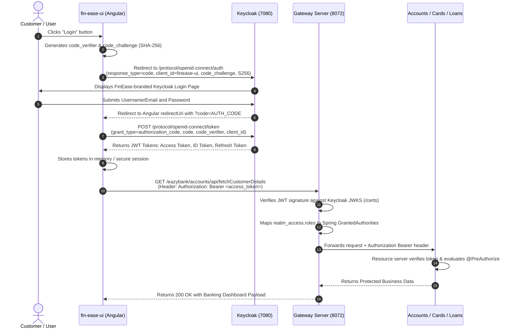
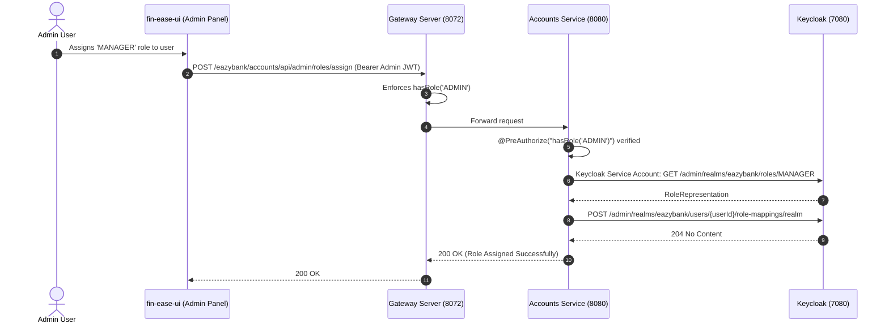

# Keycloak OIDC Authentication, Authorization & Microservices Security Implementation Plan

> **Project:** EasyBank Microservices Ecosystem  
> **Backend:** Spring Boot 4.x / Spring Cloud 2025.x / Java 25  
> **Frontend:** Angular 20/22 Standalone (`fin-ease-ui`)  
> **Identity Provider:** Keycloak 26.7.3 (`docker-compose-infra.yml`)  
> **Gateway:** Spring Cloud Gateway (`gatewayserver`) with Redis & Resilience4j  

---

## 1. Executive Summary

This document specifies the end-to-end implementation plan for integrating **Keycloak Identity & Access Management (IAM)** into the **EasyBank Microservices** platform. 

The architecture fulfills all 5 core security requirements:
1. **User Registration:** Angular invokes Spring Boot, which leverages a restricted Keycloak Service Account to create users via the Keycloak Admin REST API.
2. **User Login:** Angular implements OpenID Connect (OIDC) **Authorization Code Flow with Proof Key for Code Exchange (PKCE)**, optionally coupled with a custom FinEase-branded Keycloak login theme.
3. **Role-Based Authorization:** Spring Security validates Keycloak-issued JSON Web Tokens (JWTs) and enforces role restrictions (`ADMIN`, `USER`, `MANAGER`).
4. **Role Assignment:** A protected administrative endpoint in Spring Boot utilizes the service account to assign Keycloak realm roles.
5. **Microservices Protection (Zero Trust):** Dual-layer defense with the Spring Cloud Gateway performing perimeter token validation and downstream microservices (`accounts`, `cards`, `loans`) acting as OAuth 2.0 Resource Servers with method-level authorization.

---

## 2. Architecture & Sequence Flows

### 2.1. End-to-End Authentication & Authorization Architecture



---

### 2.2. Sequence Diagrams

#### Flow A: User Registration (Angular → Spring Boot → Keycloak Admin API)



#### Flow B: User Login (OIDC Authorization Code Flow with PKCE)



#### Flow C: Role Assignment (Admin-Protected Endpoint)



---

## 3. Phase-by-Phase Implementation Plan

### Phase 1: Keycloak Configuration (Realm, Clients, & Roles)

#### 1.1 Realm Creation
- Realm Name: `eazybank`
- Enable user registration if direct self-service is desired; however, per requirement, registration will route through Spring Boot for unified customer record creation.

#### 1.2 Realm Roles Creation
Create 3 realm roles:
- `ADMIN`: Full administrative control, system metrics, role assignment.
- `MANAGER`: Branch management, approving loans, modifying card limits.
- `USER`: Standard retail banking customer (viewing own accounts, cards, loans).

#### 1.3 Client Configurations
1. **Public Client: `finease-ui`** (for Angular Single Page App)
   - **Client ID**: `finease-ui`
   - **Client Authentication**: `OFF` (Public Client)
   - **Authentication Flow**: Standard Flow (Authorization Code)
   - **PKCE**:
     - `Proof Key for Code Exchange Code Challenge Method`: `S256`
   - **Valid Redirect URIs**: `http://localhost:4200/*`
   - **Web Origins**: `http://localhost:4200`
   - **Post Logout Redirect URIs**: `http://localhost:4200/login`

2. **Confidential Client: `backend-admin-client`** (for Spring Boot Service Account)
   - **Client ID**: `backend-admin-client`
   - **Client Authentication**: `ON` (Generates client secret)
   - **Authentication Flow**: Service Accounts Roles enabled (Client Credentials Grant)
   - **Service Account Roles Assignment**:
     - Navigate to `Service Account Roles` → assign `realm-management` client roles:
       - `manage-users` (needed to create users, update passwords, and assign roles)
       - `view-users`
       - `query-users`

---

### Phase 2: User Registration & Admin APIs in Spring Boot (`accounts`)

#### 2.1 Dependencies in `accounts/pom.xml`
Add the Keycloak Admin Client and Spring Security dependencies:

```xml
<!-- Keycloak Admin Client -->
<dependency>
    <groupId>org.keycloak</groupId>
    <artifactId>keycloak-admin-client</artifactId>
    <version>26.1.3</version>
</dependency>

<!-- Spring Security OAuth2 Resource Server -->
<dependency>
    <groupId>org.springframework.boot</groupId>
    <artifactId>spring-boot-starter-security</artifactId>
</dependency>
<dependency>
    <groupId>org.springframework.boot</groupId>
    <artifactId>spring-boot-starter-security-oauth2-resource-server</artifactId>
</dependency>
```

#### 2.2 Keycloak Admin Client Configuration Bean
In `com.eazybytes.accounts.config.KeycloakClientConfig`:

```java
@Configuration
public class KeycloakClientConfig {

    @Value("${keycloak.server-url:http://localhost:7080}")
    private String serverUrl;

    @Value("${keycloak.realm:eazybank}")
    private String realm;

    @Value("${keycloak.client-id:backend-admin-client}")
    private String clientId;

    @Value("${keycloak.client-secret}")
    private String clientSecret;

    @Bean
    public Keycloak keycloakAdminClient() {
        return KeycloakBuilder.builder()
                .serverUrl(serverUrl)
                .realm(realm)
                .grantType(OAuth2Constants.CLIENT_CREDENTIALS)
                .clientId(clientId)
                .clientSecret(clientSecret)
                .build();
    }
}
```

#### 2.3 Registration DTO & Logic
In `com.eazybytes.accounts.dto.UserRegistrationDto`:
```java
@Data
public class UserRegistrationDto {
    @NotEmpty(message = "Name cannot be null or empty")
    private String name;

    @NotEmpty(message = "Email cannot be null or empty")
    @Email(message = "Email address should be a valid value")
    private String email;

    @Pattern(regexp = "^$|[0-9]{10}", message = "Mobile number must be 10 digits")
    private String mobileNumber;

    @NotEmpty(message = "Password cannot be null or empty")
    @Size(min = 8, message = "Password must have at least 8 characters")
    private String password;
}
```

Service Layer Implementation (`KeycloakUserService`):
```java
@Service
@RequiredArgsConstructor
public class KeycloakUserService {

    private final Keycloak keycloak;
    private final IAccountService accountService;

    @Value("${keycloak.realm:eazybank}")
    private String realm;

    @Transactional
    public void registerUser(UserRegistrationDto dto) {
        UsersResource usersResource = keycloak.realm(realm).users();

        // 1. Prepare User Representation
        UserRepresentation user = new UserRepresentation();
        user.setUsername(dto.getEmail());
        user.setEmail(dto.getEmail());
        user.setFirstName(dto.getName());
        user.setEnabled(true);
        user.setEmailVerified(true);
        user.setAttributes(Map.of("mobileNumber", List.of(dto.getMobileNumber())));

        // 2. Create User in Keycloak
        Response response = usersResource.create(user);
        if (response.getStatus() != 201) {
            throw new CustomerAlreadyExistsException("Failed to register user in Keycloak: " + response.getStatusInfo());
        }

        String userId = CreatedResponseUtil.getCreatedId(response);

        // 3. Set Password
        CredentialRepresentation credential = new CredentialRepresentation();
        credential.setTemporary(false);
        credential.setType(CredentialRepresentation.PASSWORD);
        credential.setValue(dto.getPassword());
        usersResource.get(userId).resetPassword(credential);

        // 4. Assign Default Role "USER"
        RoleRepresentation userRole = keycloak.realm(realm).roles().get("USER").toRepresentation();
        usersResource.get(userId).roles().realmLevel().add(Collections.singletonList(userRole));

        // 5. Create Core Banking Customer & Account Record
        CustomerDto customerDto = new CustomerDto();
        customerDto.setName(dto.getName());
        customerDto.setEmail(dto.getEmail());
        customerDto.setMobileNumber(dto.getMobileNumber());
        accountService.createAccount(customerDto);
    }
}
```

#### 2.4 Role Assignment Endpoint
In `com.eazybytes.accounts.controller.AdminController`:
```java
@RestController
@RequestMapping(path = "/api/admin", produces = MediaType.APPLICATION_JSON_VALUE)
@RequiredArgsConstructor
public class AdminController {

    private final Keycloak keycloak;

    @Value("${keycloak.realm:eazybank}")
    private String realm;

    @PostMapping("/roles/assign")
    @PreAuthorize("hasRole('ADMIN')")
    public ResponseEntity<ResponseDto> assignRole(@RequestBody @Valid RoleAssignmentDto dto) {
        UserRepresentation user = keycloak.realm(realm).users().searchByUsername(dto.getUsername(), true)
                .stream().findFirst()
                .orElseThrow(() -> new ResourceNotFoundException("User", "username", dto.getUsername()));

        RoleRepresentation targetRole = keycloak.realm(realm).roles().get(dto.getRoleName()).toRepresentation();
        keycloak.realm(realm).users().get(user.getId()).roles().realmLevel().add(List.of(targetRole));

        return ResponseEntity.ok(new ResponseDto("200", "Role assigned successfully"));
    }
}
```

---

### Phase 3: API Gateway & Microservices Resource Server Hardening

#### 3.1 Gateway Server (`gatewayserver`) Updates
1. **Update `application.yaml`**:
   Change realm from `master` to `eazybank`:
   ```yaml
   spring:
     security:
       oauth2:
         resourceserver:
           jwt:
             jwk-set-uri: "http://localhost:7080/realms/eazybank/protocol/openid-connect/certs"
   ```

2. **Enhance `KeyclockRoleConverter.java`**:
   Support both Realm roles and Client roles, prefixing with `ROLE_`:
   ```java
   public class KeyclockRoleConverter implements Converter<Jwt, Collection<GrantedAuthority>> {
       @Override
       public Collection<GrantedAuthority> convert(Jwt jwt) {
           Map<String, Object> realmAccess = (Map<String, Object>) jwt.getClaims().get("realm_access");
           if (realmAccess == null || realmAccess.isEmpty()) {
               return List.of();
           }
           List<String> roles = (List<String>) realmAccess.get("roles");
           return roles.stream()
                   .map(role -> new SimpleGrantedAuthority("ROLE_" + role.toUpperCase()))
                   .collect(Collectors.toList());
       }
   }
   ```

3. **Gateway `SecurityConfig.java` Route Authorization**:
   ```java
   serverHttpSecurity
       .cors(corsSpec -> corsSpec.configurationSource(corsConfigurationSource()))
       .csrf(ServerHttpSecurity.CsrfSpec::disable)
       .authorizeExchange(exchanges -> exchanges
           .pathMatchers(HttpMethod.OPTIONS).permitAll()
           // Public registration & swagger
           .pathMatchers("/eazybank/accounts/api/register").permitAll()
           .pathMatchers("/actuator/**", "/swagger-ui/**", "/v3/api-docs/**").permitAll()
           // Protected endpoints
           .pathMatchers("/eazybank/*/api/admin/**").hasRole("ADMIN")
           .pathMatchers("/eazybank/loans/api/approve/**").hasAnyRole("MANAGER", "ADMIN")
           .pathMatchers("/eazybank/**").hasAnyRole("USER", "MANAGER", "ADMIN")
           .anyExchange().authenticated()
       )
       .oauth2ResourceServer(o -> o.jwt(jwt -> jwt.jwtAuthenticationConverter(grantedAuthoritiesExtraction())));
   ```

#### 3.2 Microservice-Level Defense-in-Depth (`accounts`, `cards`, `loans`)
1. Add dependencies `spring-boot-starter-security` and `spring-boot-starter-security-oauth2-resource-server` to each microservice's `pom.xml`.
2. Configure centralized config in [easybank-config/](file:///d:/Spring%20Boot%20Microservices%20Notes/Banking%20Rabbit%20MQ/Spring%20Boot%20Microservices/easybank-config):
   ```yaml
   spring:
     security:
       oauth2:
         resourceserver:
           jwt:
             jwk-set-uri: "http://localhost:7080/realms/eazybank/protocol/openid-connect/certs"
   ```
3. Enable Method Security in each microservice:
   ```java
   @Configuration
   @EnableWebSecurity
   @EnableMethodSecurity(prePostEnabled = true)
   public class SecurityConfig {
       @Bean
       public SecurityFilterChain securityFilterChain(HttpSecurity http) throws Exception {
           http
               .csrf(AbstractHttpConfigurer::disable)
               .authorizeHttpRequests(auth -> auth
                   .requestMatchers("/api/register").permitAll()
                   .requestMatchers("/h2-console/**", "/actuator/**", "/swagger-ui/**", "/v3/api-docs/**").permitAll()
                   .anyRequest().authenticated()
               )
               .oauth2ResourceServer(oauth2 -> oauth2
                   .jwt(jwt -> jwt.jwtAuthenticationConverter(jwtAuthenticationConverter()))
               );
           return http.build();
       }

       @Bean
       public JwtAuthenticationConverter jwtAuthenticationConverter() {
           JwtAuthenticationConverter converter = new JwtAuthenticationConverter();
           converter.setJwtGrantedAuthoritiesConverter(new KeycloakRoleConverter());
           return converter;
       }
   }
   ```

#### 3.3 OpenFeign Token Propagation Interceptor
When `accounts` calls `cards` or `loans` via OpenFeign, relay the Bearer token:
```java
@Component
public class FeignClientInterceptor implements RequestInterceptor {
    @Override
    public void apply(RequestTemplate template) {
        Authentication authentication = SecurityContextHolder.getContext().getAuthentication();
        if (authentication instanceof JwtAuthenticationToken jwtAuth) {
            template.header(HttpHeaders.AUTHORIZATION, "Bearer " + jwtAuth.getToken().getTokenValue());
        }
    }
}
```

---

### Phase 4: Angular Frontend Integration (`fin-ease-ui`)

#### 4.1 Install OIDC PKCE Library
From `fin-ease-ui/`:
```bash
npm install angular-oauth2-oidc
```

#### 4.2 Auth Configuration (`auth.config.ts`)
```typescript
import { AuthConfig } from 'angular-oauth2-oidc';

export const authCodeFlowConfig: AuthConfig = {
  issuer: 'http://localhost:7080/realms/eazybank',
  redirectUri: window.location.origin + '/dashboard',
  clientId: 'finease-ui',
  responseType: 'code',
  scope: 'openid profile email roles',
  showDebugInformation: true,
  requireHttps: false // For local development on localhost
};
```

#### 4.3 Refactor Angular `AuthService`
Update [fin-ease-ui/src/app/core/services/auth.service.ts](file:///d:/Spring%20Boot%20Microservices%20Notes/Banking%20Rabbit%20MQ/Spring%20Boot%20Microservices/fin-ease-ui/src/app/core/services/auth.service.ts):
```typescript
import { Injectable, signal } from '@angular/core';
import { OAuthService } from 'angular-oauth2-oidc';
import { authCodeFlowConfig } from '../config/auth.config';

@Injectable({ providedIn: 'root' })
export class AuthService {
  currentUser = signal<any>(null);
  userRoles = signal<string[]>([]);

  constructor(private oauthService: OAuthService) {
    this.initOAuth();
  }

  private async initOAuth() {
    this.oauthService.configure(authCodeFlowConfig);
    await this.oauthService.loadDiscoveryDocumentAndTryLogin();
    if (this.oauthService.hasValidAccessToken()) {
      this.loadUserProfile();
    }
  }

  login() {
    this.oauthService.initCodeFlow();
  }

  logout() {
    this.oauthService.logOut();
    this.currentUser.set(null);
    this.userRoles.set([]);
  }

  hasRole(role: string): boolean {
    return this.userRoles().includes(role.toUpperCase());
  }

  getAccessToken(): string {
    return this.oauthService.getAccessToken();
  }

  private loadUserProfile() {
    const claims = this.oauthService.getIdentityClaims() as any;
    const realmAccess = (claims?.realm_access?.roles || []) as string[];
    this.userRoles.set(realmAccess.map(r => r.toUpperCase()));
    this.currentUser.set({
      name: claims?.name || claims?.preferred_username,
      email: claims?.email,
      mobileNumber: claims?.mobileNumber
    });
  }
}
```

#### 4.4 Functional HTTP Interceptor (`auth.interceptor.ts`)
Attaches the Bearer token to all requests routed to the Gateway (`http://localhost:8072`):
```typescript
import { HttpInterceptorFn } from '@angular/common/http';
import { inject } from '@angular/core';
import { AuthService } from '../services/auth.service';

export const authInterceptor: HttpInterceptorFn = (req, next) => {
  const authService = inject(AuthService);
  const token = authService.getAccessToken();

  if (token && req.url.includes('8072')) {
    const cloned = req.clone({
      setHeaders: { Authorization: `Bearer ${token}` }
    });
    return next(cloned);
  }
  return next(req);
};
```

Register in `app.config.ts`:
```typescript
provideHttpClient(withInterceptors([authInterceptor]))
```

#### 4.5 Keycloak Login Theme Customization
To match the FinEase design:
1. Create a theme directory: `keycloak/themes/finease/login/`.
2. Define `theme.properties`:
   ```properties
   parent=keycloak
   styles=css/finease.css
   ```
3. Add `css/finease.css` matching FinEase color palette (`#0f172a`, `#3b82f6`, `#10b981`, rounded cards, clean fonts).
4. In Keycloak Admin Console: `Realm Settings` → `Themes` → Select `finease` for Login Theme.

---

## 4. Verification & Testing Matrix

| Test Case | Method & Endpoint | Payload / Header | Expected Result |
| :--- | :--- | :--- | :--- |
| **TC-01: User Registration** | `POST http://localhost:8072/eazybank/accounts/api/register` | JSON: `{ "name": "Test User", "email": "test@bank.com", "mobileNumber": "9876543210", "password": "Password@123" }` | `201 Created` in Spring Boot; user is created in Keycloak with role `USER` and DB has account record. |
| **TC-02: OIDC Login with PKCE** | Trigger via Angular Login Button | Authorization Code Flow with `code_challenge` (S256) | Keycloak authenticates user, redirects with code, Angular exchanges for JWT access token. |
| **TC-03: Fetch Accounts as USER** | `GET http://localhost:8072/eazybank/accounts/api/fetch?mobileNumber=9876543210` | Header: `Authorization: Bearer <USER_JWT>` | `200 OK` with account details. |
| **TC-04: RBAC Unauthorized Check** | `POST http://localhost:8072/eazybank/accounts/api/admin/roles/assign` | Header: `Authorization: Bearer <USER_JWT>` | `403 Forbidden` (Enforced by Gateway & Spring Security). |
| **TC-05: RBAC Role Assignment by ADMIN** | `POST http://localhost:8072/eazybank/accounts/api/admin/roles/assign` | Header: `Authorization: Bearer <ADMIN_JWT>`<br/>Body: `{ "username": "test@bank.com", "roleName": "MANAGER" }` | `200 OK`; Keycloak user now possesses `ROLE_MANAGER`. |
| **TC-06: Direct Microservice Zero-Trust** | `GET http://localhost:8080/api/fetchCustomerDetails?mobileNumber=9876543210` | No Authorization Header | `401 Unauthorized` (Direct microservice call rejected without valid JWT). |

---

## 5. Summary of Recommended Code Changes

| Component | Target File | Action Required |
| :--- | :--- | :--- |
| **Keycloak** | Keycloak Console / Realm Export | Create `eazybank` realm, `finease-ui` (PKCE public), `backend-admin-client` (service account), and roles (`ADMIN`, `USER`, `MANAGER`). |
| **Gateway** | [gatewayserver/.../SecurityConfig.java](file:///d:/Spring%20Boot%20Microservices%20Notes/Banking%20Rabbit%20MQ/Spring%20Boot%20Microservices/gatewayserver/src/main/java/com/easybank/gatewayserver/config/SecurityConfig.java) | Update route matchers for `ROLE_ADMIN`, `ROLE_MANAGER`, `ROLE_USER`, and permit `/api/register`. |
| **Gateway** | [gatewayserver/.../KeyclockRoleConverter.java](file:///d:/Spring%20Boot%20Microservices%20Notes/Banking%20Rabbit%20MQ/Spring%20Boot%20Microservices/gatewayserver/src/main/java/com/easybank/gatewayserver/config/KeyclockRoleConverter.java) | Map `realm_access.roles` to `ROLE_<ROLE_NAME>`. |
| **Gateway** | [gatewayserver/.../application.yaml](file:///d:/Spring%20Boot%20Microservices%20Notes/Banking%20Rabbit%20MQ/Spring%20Boot%20Microservices/gatewayserver/src/main/resources/application.yaml) | Update `jwk-set-uri` to point to `/realms/eazybank/...`. |
| **Accounts** | [accounts/pom.xml](file:///d:/Spring%20Boot%20Microservices%20Notes/Banking%20Rabbit%20MQ/Spring%20Boot%20Microservices/accounts/pom.xml) | Add `keycloak-admin-client` and OAuth2 Resource Server dependencies. |
| **Accounts** | `accounts/src/.../KeycloakUserService.java` | Implement registration and role assignment via Admin REST API. |
| **Cards & Loans** | `pom.xml` & `SecurityConfig.java` | Add OAuth2 Resource Server and enable `@EnableMethodSecurity`. |
| **Frontend** | [fin-ease-ui/package.json](file:///d:/Spring%20Boot%20Microservices%20Notes/Banking%20Rabbit%20MQ/Spring%20Boot%20Microservices/fin-ease-ui/package.json) | Add `angular-oauth2-oidc`. |
| **Frontend** | [fin-ease-ui/.../auth.service.ts](file:///d:/Spring%20Boot%20Microservices%20Notes/Banking%20Rabbit%20MQ/Spring%20Boot%20Microservices/fin-ease-ui/src/app/core/services/auth.service.ts) | Replace mock authentication with PKCE authorization code flow. |
