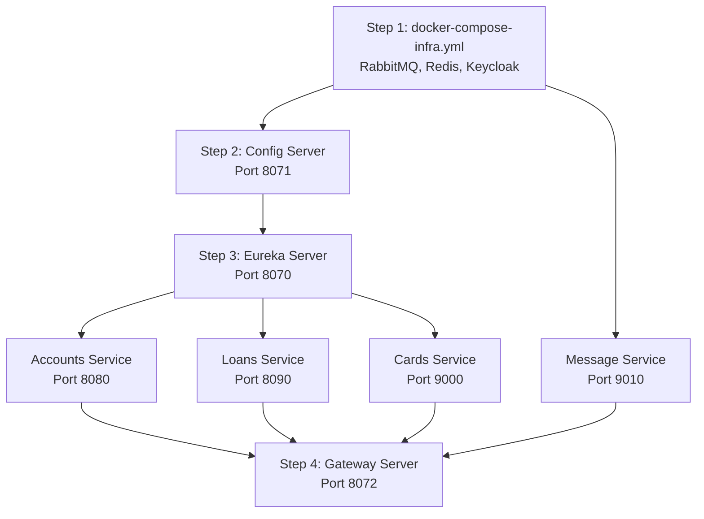

# Local Development Guide: Running EasyBank Microservices in IDE

This guide details the complete procedure to run and debug the **EasyBank Microservices** architecture locally on your machine using your preferred IDE (e.g., IntelliJ IDEA, VS Code, or Eclipse).

---

## 1. Prerequisites

Before starting, ensure the following tools are installed and available on your system path:

- **JDK**: Java 25 (LTS)
- **Maven**: Version 3.9+
- **Docker & Docker Desktop**: Running (used for backing infrastructure: RabbitMQ, Redis, Keycloak)
- **IDE**: IntelliJ IDEA (Recommended), Eclipse, or VS Code with Spring Boot Extension Pack
- **Lombok Plugin**: Installed and enabled in your IDE

---

## 2. Architecture & Ports Overview

| Component | Type | Local Port | Dashboard / UI | Credentials |
| :--- | :--- | :--- | :--- | :--- |
| **RabbitMQ** | Infrastructure (Docker) | `5672` (AMQP) / `15672` (UI) | [http://localhost:15672](http://localhost:15672) | `guest` / `guest` |
| **Redis** | Infrastructure (Docker) | `6379` | — | None |
| **Keycloak** | Infrastructure (Docker) | `7080` | [http://localhost:7080](http://localhost:7080) | `admin` / `admin` |
| **Config Server** | Spring Cloud Service | `8071` | [http://localhost:8071/actuator/health](http://localhost:8071/actuator/health) | — |
| **Eureka Server** | Service Discovery | `8070` | [http://localhost:8070](http://localhost:8070) | — |
| **Accounts** | Microservice | `8080` | [http://localhost:8080/swagger-ui.html](http://localhost:8080/swagger-ui.html) | — |
| **Loans** | Microservice | `8090` | [http://localhost:8090/swagger-ui.html](http://localhost:8090/swagger-ui.html) | — |
| **Cards** | Microservice | `9000` | [http://localhost:9000/swagger-ui.html](http://localhost:9000/swagger-ui.html) | — |
| **Message** | Microservice | `9010` | RabbitMQ Stream Consumer | — |
| **Gateway Server**| API Gateway | `8072` | [http://localhost:8072/actuator/gateway/routes](http://localhost:8072/actuator/gateway/routes) | — |
| **FinEase UI** | Angular 22 Frontend | `4200` | [http://localhost:4200](http://localhost:4200) | Persona switch or Keycloak SSO |

---

## 3. Step 1: Start Backing Infrastructure (Docker)

The microservices require RabbitMQ, Redis, and Keycloak. Rather than installing these standalone on your OS, run the lightweight root [`docker-compose-infra.yml`](./docker-compose-infra.yml):

```powershell
docker compose -f docker-compose-infra.yml up -d
```

### Verify Container Status:
```powershell
docker compose -f docker-compose-infra.yml ps
```
You should see:
- `rabbitmq-infra` (healthy on ports `5672`, `15672`)
- `redis-infra` (healthy on port `6379`)
- `keycloak-infra` (healthy on port `7080`)

---

## 4. Step 2: Configure Your IDE

### A. Load Maven Multi-Module Project
The root [`pom.xml`](./pom.xml) links all 7 microservice modules.
1. Open the project root directory in your IDE:
   `Spring Boot Microservices`
2. Open the **Maven** sidebar tool window and click **Reload All Maven Projects** (🔄).
3. Ensure all 7 modules appear under the Maven tool window:
   - `configserver`
   - `eurekaserver`
   - `accounts`
   - `cards`
   - `loans`
   - `gatewayserver`
   - `message`

### B. Set Java SDK
1. Open **File → Project Structure → Project** (`Ctrl+Alt+Shift+S`).
2. Set **SDK** to **JDK 25**.
3. Set **Language level** to **25**.

### C. Enable Annotation Processing (Lombok)
`accounts`, `cards`, and `loans` use Project Lombok annotations (`@Data`, `@Getter`, `@Setter`).
1. Open **Settings / Preferences** (`Ctrl+Alt+S`).
2. Navigate to **Build, Execution, Deployment → Compiler → Annotation Processors**.
3. Check **Enable annotation processing**.
4. Click **Apply** and **OK**.

---

## 5. Step 3: Startup Sequence

> [!IMPORTANT]
> Because microservices fetch configuration from Config Server and register with Eureka, **strictly follow the startup order below**.



### 1. Start Config Server (Port 8071)
- **Class**: `com.easybank.configserver.ConfigserverApplication`
- **Path**: `configserver/src/main/java/com/easybank/configserver/ConfigserverApplication.java`
- **Wait for**: Console logs to indicate server running on port `8071`.
- **Health Check**: Open [http://localhost:8071/actuator/health](http://localhost:8071/actuator/health).
- **Tip**: Default profile connects to GitHub repo. If you work offline, change `spring.profiles.active: native` in `configserver/src/main/resources/application.yaml`.

### 2. Start Eureka Server (Port 8070)
- **Class**: `com.easybank.eurekaserver.EurekaserverApplication`
- **Path**: `eurekaserver/src/main/java/com/easybank/eurekaserver/EurekaserverApplication.java`
- **Wait for**: Console logs to display Eureka initialization.
- **Dashboard**: Open [http://localhost:8070](http://localhost:8070) (Instances list will populate as core services start).

### 3. Start Core Microservices (Can be started in parallel)
- **Accounts Service** (Port 8080):
  - **Class**: `com.eazybytes.accounts.AccountsApplication`
  - Connects to Config Server, Eureka, and RabbitMQ.
  - H2 Console: [http://localhost:8080/h2-console](http://localhost:8080/h2-console) (JDBC URL: `jdbc:h2:mem:testdb`)
- **Loans Service** (Port 8090):
  - **Class**: `com.eazybytes.loans.LoansApplication`
  - H2 Console: [http://localhost:8090/h2-console](http://localhost:8090/h2-console) (JDBC URL: `jdbc:h2:mem:testdb`)
- **Cards Service** (Port 9000):
  - **Class**: `com.eazybytes.cards.CardsApplication`
  - H2 Console: [http://localhost:9000/h2-console](http://localhost:9000/h2-console) (JDBC URL: `jdbc:h2:mem:testdb`)
- **Message Service** (Port 9010):
  - **Class**: `com.eazybytes.message.MessageApplication`
  - Consumes messages published by the `accounts` service via RabbitMQ exchange `send-communication`.

### 4. Start API Gateway Server (Port 8072)
- **Class**: `com.easybank.gatewayserver.GatewayserverApplication`
- **Path**: `gatewayserver/src/main/java/com/easybank/gatewayserver/GatewayserverApplication.java`
- Connects to Eureka for service discovery, Redis for rate limiting, and Keycloak for JWT token verification.

### 5. Start FinEase Angular Frontend (Port 4200)
- In your IDE terminal or command prompt:
  ```powershell
  cd fin-ease-ui
  npm start
  ```
- Open your browser at [http://localhost:4200](http://localhost:4200)
- **Authentication Modes**:
  - **Keycloak SSO**: Click *"Sign in with Keycloak SSO (OIDC/PKCE)"* to perform full OAuth2 Authorization Code flow with Keycloak on port 7080.
  - **Dev Quick Personas**: Click *"Admin"*, *"Manager"*, or *"Customer"* on the login page or in the top header profile dropdown to test role-gated UI behavior and permissions instantly.

---

## 6. Pro-Tip: IntelliJ IDEA Services Dashboard

Instead of managing 7 individual run consoles:

1. Open the **Services** tool window (`Alt+8` or **View → Tool Windows → Services**).
2. Click **+ (Add Service) → Run Configuration Type → Spring Boot** (or **Application**).
3. All configured applications will be grouped under one dashboard:
   - Start/Stop all services with one click.
   - Switch between service logs easily.
   - Monitor port bindings and memory usage in real time.

---

## 7. Testing Gateway Routes

Once all services are running and registered in Eureka ([http://localhost:8070](http://localhost:8070)), call services via Gateway (`8072`):

- **Accounts via Gateway**:
  ```http
  GET http://localhost:8072/eazybank/accounts/api/fetch?mobileNumber=1234567890
  ```
- **Cards via Gateway**:
  ```http
  GET http://localhost:8072/eazybank/cards/api/fetch?mobileNumber=1234567890
  ```
- **Loans via Gateway**:
  ```http
  GET http://localhost:8072/eazybank/loans/api/fetch?mobileNumber=1234567890
  ```
- **Gateway Route Definitions**:
  ```http
  GET http://localhost:8072/actuator/gateway/routes
  ```

---

## 8. Stopping the Environment

1. In your IDE, click **Stop All** in the Services window.
2. In your terminal, stop the Docker backing services:
   ```powershell
   docker compose -f docker-compose-infra.yml down
   ```
   *(Add `-v` if you wish to wipe Redis, RabbitMQ, and Keycloak volumes)*:
   ```powershell
   docker compose -f docker-compose-infra.yml down -v
   ```
